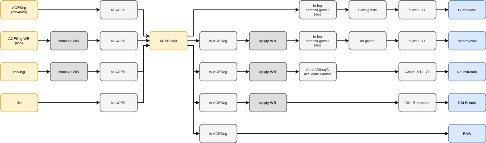

# README #

This OCIO config is basically the ACES v1.2 config with a few things added for Rodeo, and with the displays and views customized to mimick what artists are used to have.

### What is this repository for? ###

* This should be the default OCIO config to use for a new show.

### What's different from the ACES v1.2 config? ###

#### Colorspaces ####

* A `rdo` colorspace, which is the same as ACEScg. This is the colorspace that should be used for almost everything at Rodeo.
* A `rdo-nwb` colorspace, which is ACEScg, but with the white balance not applied to the image. Converting from `rdo-nwb` to `rdo` effectively applies the white balance. Source plates should be considered to arrive in this colorspace after ingestion.
* A `rdo-log` colorspace, which is the Dolby PQ 1000 nits Shaper - AP1 color space. This space gives a nice smooth looking log image, better than the ACEScc to judge the entire dynamic range of an image (IMHO).
* A `dis` colorspace, which represents the colorspace the DI will be done in. This is usually the colorspace to apply the client LUT, and should be changed per project. By default it is the AlexaV3LocC-ArriWideGamut space, which is often what we need in professional cinema.
* A `mps` colorspace, which is linear sRGB with an invertible highlight rolloff.
* A `mps-sRGBcurve` which is the same as the previous one, except with an sRGB transfer curve applied to it.
* A `gamma 2.2` colorspave, because Nuke expect this one when loading a Quicktime.

#### LUTs ####

* A `Rodeo-look` view, to display the LUT sent by the client but while still keeping the white balance and with an alternate shot-grade (which is very often empty). _This must be changed per project._
* A `Client-look` view, to display the LUT sent by the client. _This must be changed per project._
* A `Neutral-Look` view, to display a neutral LUT that doesn't change between projects. This is using the Alexa K1S1 LUT from Arri with the blacks corrected to be at zero.
* A `DSLR-Look` This is to allow the ingestion of reference images that are taken from the web of from jpeg images that were seemingly taken with a DSLR. This look is revertible. This one is used by default in the Maya viewport.
* A `ACES-Look` This is to allow the ingestion of reference images that are taken from the web of from jpeg images that were seemingly taken with a fancy DSLR. This look is revertible.

#### Displays ####

* A single display is available for the moment: `sRGB-monitor`. Others could be added later like `P3-D65-monitor` if we get the proper LUT from the client. The word "monitor" was added to the display name to make it extra clear what this is for.

#### roles ####
* color_picking: ACES-look
* color_timing: dis
* compositing_linear: rdo
* compositing_log: rdo-log
* data: Utility - Raw
* default: rdo
* matte_paint: mps-sRGBcurve
* quicktime: Output - Rec.709
* reference: Utility - Raw
* rendering: rdo
* scene_linear: rdo
* stolen_from_the_web: ACES-look
* stolen_from_the_web2: DSLR-look
* texture_paint: rdo
* 3d_viewport: DSLR-look

### Configuration inner workings ###
This OCIO config was built from the ACES v1.2 config without changing any of the colorspaces that were already in there. This means that the reference colorspace is ACES2065-1 and not ACEScg. From a user point of view, that doesn't change anything. But from a maintainer point a view, you must make sure that all transforms go to/from ACES2065-1.

Here is a schema representing various transforms used in the config.

The big new thing is the fact that the white-balance is applied implicitely inside some colorspaces. The `rdo` colorspace is considered to be white-balanced, while all the colorspaces in the ACES config are not. This means that when ingesting a plate with the conversion from `AlexaV3LogC` to `rdo-nwb`, no white-balance operation is applied. Then, converting from `rdo-nwb` to `rdo` applies the white-balance. When viewing an image in `rdo` through the `Neutral-look`, the white-balance is removed and then applied back, effectively keeping the neutral values neutral. When ingesting a reference image with the `DSLR-look` to `rdo`, the values remain neutral too.

Also, the config looks for different directories to find lut files. The first one is the `_color_bundle`, then it looks for a directory called `project_luts`, which should contain the client lut, the default white-balance and default client grade. This is the only folder that should be updated by the person doing the show setup by adding the required luts for the show. Then it looks for a directory called `rodeo_luts` which contains luts proper to Rodeo like the neutral look's lut and the DSLR luts. This folder should not be modified per project. The last folder  is the `ACES_luts` which contains luts from the ACES config. This directory should not be modified per projet.

### Who do I talk to? ###

* Francois Lord, who designed and wrote the first pass on this config.
* Jean-Francois Bouchard, who usually sets the color pipeline up for shows at Rodeo.
